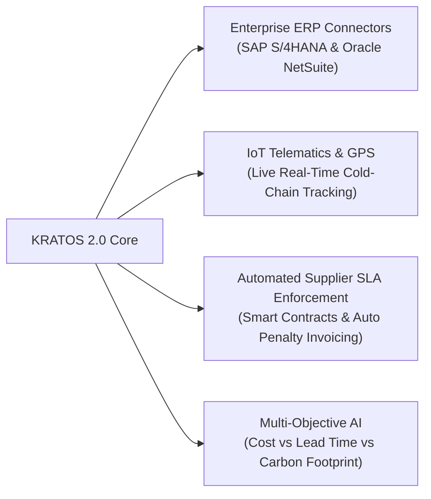

# 🏆 KRATOS — Presentation Deck & Enterprise Documentation
**Problem Statement #8:** *Autonomous Inventory Shortage Early-Warning, Multi-Hub Balancing & Technical Substitution Planner*

---

## 1. Executive Summary & Problem Context

### The Industry Challenge:
In modern multi-echelon electronics manufacturing and distribution networks, supply chain disruptions trigger compounding financial losses:
- **Upstream Bottlenecks**: Port congestion, customs clearance delays, and OEM component shortages lead to unannounced shipment delays.
- **Compounding Penalties**: Customer orders under strict Service Level Agreements (SLAs) incur severe daily late penalties (e.g., ₹1,500/day to ₹3,000/day).
- **The Failure of Traditional ERPs**: Legacy systems are static and reactive—they alert managers *after* a stockout occurs. When human planners attempt ad-hoc emergency stock transfers, they frequently deplete the donor warehouse below its safety threshold, triggering cascading stockouts across regional hubs.

### The KRATOS Solution:
**KRATOS** is an autonomous, deterministic decision-support engine and operations cockpit designed to:
1. **Forecast Shortages 7 Days in Advance**: Computes dynamic Available-to-Promise (ATP) stock and forward inventory drawdowns across regional hubs (Mumbai, Pune, Chennai, Delhi).
2. **Enforce Strict Donor Safety Barriers**: Mathematically guarantees that source warehouses never drop below their safety stock buffer plus forward customer demand.
3. **Validate Technical Component Compatibility**: Evaluates pin-compatibility, voltage matching, and form-factor specs to permit immediate on-site part substitutions.
4. **Formulate Lowest-Cost Multi-Echelon Recovery Plans**: Compares inter-hub transfers, technical substitutions, and express air reorders via deterministic cost-minimization.
5. **Execute One-Click Autonomous Mitigation**: Updates the physical ledger, schedules inbound replenishment manifests, and logs transparent audit trails with `DD/MM/YYYY` timestamps.

---

## 2. Frontend Architecture & Client-Side Logic

```
   [ Enterprise Responsive UI (HTML5 / Vanilla CSS3 / ES6+ JavaScript) ]
                                   │
       ┌───────────────────────────┼───────────────────────────┐
       ▼                           ▼                           ▼
[ Chart.js Canvas ]     [ Live SVG Network Map ]    [ Interactive Logic Engines ]
• 7-Day Stock Curves    • Coordinate mesh lines     • Safe Transfer Validator
• Arrival Milestone Pins• Dynamic cargo pulses      • Live Stock & Shock Tweaker
• Buffer Breach Danger  • Route state indicators    • Filter & Search Indexing
```

### Technology Stack:
- **Core Framework**: Semantic HTML5, Vanilla CSS3 (Custom Design System with CSS variables), Modern ES6+ JavaScript.
- **Visuals & Charting**: **Chart.js** for high-frequency time-series forecast stock trajectories with exact `DD/MM/YYYY` date indexing.
- **Network Visualization**: Interactive **Scalable Vector Graphics (SVG)** dynamic coordinate mesh representing regional transfer corridors (Mumbai, Pune, Chennai, Delhi) with live cargo pulse animations.
- **Enterprise UX Principles**: Single-screen executive layout with horizontal tab navigation (no intrusive sidebars), color-coded risk tiers (`CRITICAL`, `HIGH`, `MEDIUM`, `HEALTHY`), and non-blocking toast notifications.

### Client-Side Business Logic:
1. **Real-Time Safety Barrier Verification**:
   $$\text{Max Safe Transfer} = \max(0, \text{Available Stock} - \text{Safety Buffer} - \text{7-Day Projected Demand})$$
   If the user-selected transfer quantity exceeds this threshold, a visual red alert banner pops up with a 1-click **"Auto-Adjust to Safe Limit"** button.
2. **Deterministic State Synchronization**: Asynchronous REST polling and optimistic UI updates for instant feedback during scenario simulations and transfer executions.
3. **Live Judge Scenario Tweaker**: An embedded state controller that dynamically updates physical stock, supplier delays, and demand surge multipliers without requiring page reloads or server restarts.

---

## 3. Backend Architecture & The Autonomous Decision Engine

```
                       [ FastAPI Backend Gateway ]
                                   │
       ┌───────────────────────────┼───────────────────────────┐
       ▼                           ▼                           ▼
[ Inventory & ATP Engine ] [ 7-Day Forecasting Engine ] [ Multi-Echelon Optimizer ]
• Available-to-Promise     • Dynamic consumption curves • Landed Cost Minimizer
• Physical Ledger Updates  • Inbound arrival milestones • Compatibility Validator
• Buffer Threshold Checks  • Lead-time delay shifts     • 4-Tier Fallback Cascade
```

### Technology Stack & Libraries:
- **Framework**: **FastAPI** (Python 3.10+) for high-throughput, low-latency asynchronous REST APIs.
- **Server Engine**: **Uvicorn** ASGI server running deterministic in-memory simulation isolation.
- **Data Validation & Typing**: **Pydantic** & standard Python typing for schema integrity.
- **Deterministic Math Engine**: Pure Python Operations Research (OR) algorithms (Mixed-Integer Cost Minimization) ensuring 100% reproducible decisions without non-deterministic hallucinations.

### Mathematical Formulations:

#### A. Available-to-Promise (ATP) Stock:
$$\text{Available Stock} = \max(0, \text{On-Hand Physical Stock} - \text{Reserved Customer Commitments})$$

#### B. 7-Day Forward Inventory Trajectory:
$$\text{Projected Stock}(t) = \text{Current Stock} - \sum_{\tau=1}^{t} \text{Daily Demand}(\tau) + \sum_{\tau=1}^{t} \text{Inbound Deliveries}(\tau)$$
*A shortage alert is triggered at $t^*$ where $\text{Projected Stock}(t^*) < \text{Safety Buffer}$.*

#### C. Landed Recovery Cost Minimization:
$$\min_{\text{action} \in \mathcal{A}} \left[ \text{Direct Cost}(\text{action}) + \text{Freight Cost}(\text{action}) + \text{Late SLA Penalties}(\text{action}) \right]$$

*Subject to strict operational constraints:*
1. **Donor Safety Constraint**:
   $$\text{Donor Available} - \text{Transfer Qty} \ge \text{Donor Safety Buffer} + \text{Donor 7-Day Demand}$$
2. **Technical Compatibility Constraint**:
   $$\text{Substitute Compatibility Score} = 1.0 \quad (\text{matching voltage, wattage, and pin-out})$$
3. **Time Constraint**:
   $$\text{Lead Time}(\text{action}) \le \text{Customer Delivery Deadline}$$

---

## 4. End-to-End Walkthrough: Tab-by-Tab Showcase

### Tab 1: Warehouse Overview *(The Executive Command Center)*
- **Executive KPI Strip**: Real-time summary across all 4 hubs: Monitored Items, At-Risk Items, Threatened Orders, Est. Disruption Cost, and Verified Recovery Options.
- **Early Warning Alert Banner**: Flashing alert detailing impending stockout dates and impacted components.
- **2x2 Regional Warehouse Grid**: Live cards for **Mumbai, Pune, Chennai, and Delhi** showing physical vs available stock, inbound units, and safety status.
- **Interactive Trajectory Chart**: Selecting any warehouse card renders a dynamic 7-day drawdown curve with customer drawdowns and arrival milestones.

### Tab 2: Stock & Products *(Deep Inventory Ledger & Live Tweaker)*
- **Live Judge Stock & Demand Tweaker**: Allows judges to select any Warehouse and SKU, change on-hand or reserved stock, and click **"Apply Live Stock Change"** to test algorithm adaptability.
- **Multi-Warehouse SKU Ledger**: Searchable table displaying physical stock, reserved stock, available units, planned inbounds, safety buffer, daily demand, and forward risk tier.
- **Cross-Warehouse Product Matrix**: Instant comparative view of any single SKU across all 4 regional hubs to locate network surplus.

### Tab 3: Transfer & Substitution *(Autonomous Routing & Technical Validation)*
- **Interactive SVG Route Map**: Visualizes the logistics corridor between hubs with active transit lines and animated cargo pulses.
- **Safe Transfer Evaluation Console**: Calculates freight cost, transit duration, and warns against donor buffer breaches.
- **Component Compatibility Engine**: Pre-evaluates all 8 SKUs into **Approved Compatible Substitutes** (e.g., *65W GaN Pro* for *65W Standard*) vs **Incompatible Alternatives** (rejected due to voltage/pin mismatch).

### Tab 4: Supplier Deliveries *(Forward Replenishment & Inbound Tracking)*
- **4-Warehouse Forward Stock Replenishment Plan**: Dedicated forward projection cards for Mumbai, Pune, Chennai, and Delhi showing current stock, pending inbounds, and end-of-week health.
- **Inbound Deliveries Ledger**: Live tracking of purchase orders and inter-hub transfers with supplier delay days and revised arrival dates in exact `DD/MM/YYYY`.
- **Delay Root-Cause Analysis**: Identifies port and customs bottlenecks causing supply chain lag.

### Tab 5: Recommended Strategy *(Official Problem Statement #8 Cockpit)*
- **Crisis Briefing Banner**: Core shipment `#SHIP-001` (100 units 65W Fast Chargers from VoltTech) delayed by 4 days due to port customs.
- **Competing Orders Table**: Competing customer orders (`ORD-2001`, `ORD-2002`, `ORD-2005`) facing up to ₹28,500 in contractual breach penalties.
- **Autonomous Strategy Evaluation Matrix**: Ranks recovery options side-by-side:
  - **Rank #1**: Inter-Hub Transfer (Mumbai $\to$ Pune, ₹320 landed cost, 1-day transit).
  - **Rank #2**: On-Site Technical Part Substitution (65W GaN Pro, ₹0 freight, 0-day lead time).
  - **Rank #3**: Express Air-Freight Emergency PO (₹1,800 surge cost, 2-day transit).
  - **Rejected**: Status-Quo Delayed Delivery (Rejected due to ₹4,200 SLA penalties).
- **1-Click Recovery Execution**: Clicking **"Execute Recommended Recovery Plan"** immediately dispatches the transfer, performs on-site substitutions, and transitions Pune from **CRITICAL** to **HEALTHY** with smooth animations.
- **Multi-Echelon Fallback Hierarchy (Zero-Surplus Protocol)**: Clearly explains what happens when *no other warehouse has surplus stock* (4-Tier cascade from on-site substitutions to express air courier and SLA order rationing).
- **Interactive Disruption Stress-Testing**: Judge sliders for Demand Surges, Supplier Delay Days, and Freight Multipliers with real-time delta impact tables.

### Tab 6: Decision History *(Explainable AI & Compliance Audit Trail)*
- **Transparent Mathematical Reasoning**: Explains *why* the winning strategy was chosen and *why* alternatives were rejected.
- **Compliance CSV Export**: One-click download of `kratos_audit_*.csv` for corporate governance and supply chain audit compliance.

---

## 5. Zero-Surplus Contingency Protocol (What If No Other Hub Has Stock?)

When Warehouse A is in a critical deficit and **no other regional warehouse has surplus stock**, KRATOS activates its **4-Tier Autonomous Fallback Cascade**:

```
[ Tier 1: Inter-Hub Transfer ] 
 ↳ Condition: Other regional hub has surplus > safety buffer
 ↳ Lead Time: 1 Day | Cost: ₹320 Landed Cost

       ▼ (If all other warehouses are supply-constrained)

[ Tier 2: On-Site Technical Substitution ] 
 ↳ Condition: Pre-approved pin & voltage matched alternative on-hand (e.g. 65W GaN Pro)
 ↳ Lead Time: 0 Days (Instant) | Cost: ₹0 Freight

       ▼ (If local substitutes are also depleted)

[ Tier 3: Express Air-Freight Reorder ] 
 ↳ Condition: Expedited Tier-1 OEM PO via dedicated air courier
 ↳ Lead Time: 2 Days | Cost: ₹1,800 Surge (Prevents ₹1,500/day SLA Penalty)

       ▼ (If nationwide network supply is completely dry)

[ Tier 4: Priority Order Rationing ] 
 ↳ Condition: Algorithmic allocation to highest SLA penalty contracts first (AeroSys Corp)
 ↳ Lead Time: Dynamic | Cost: Minimizes total contractual penalty & churn
```

---

## 6. Strong Future Scope & Enterprise Roadmap



1. **Enterprise ERP & WMS Bi-Directional Connectors**:
   - Out-of-the-box integration via REST/GraphQL into SAP S/4HANA, Oracle NetSuite, and Microsoft Dynamics 365 for automated Purchase Order generation and EDI dispatch.
2. **Real-Time IoT Cargo & GPS Telematics**:
   - Integration with active GPS trackers, RFID port gates, and temperature sensors to detect transport breakdowns or customs delays *hours before* trucks reach hub gates.
3. **Automated Supplier Penalty Enforcement via Smart Contracts**:
   - Programmatically deduct contractual delay penalties from supplier invoices whenever inbound shipments breach agreed lead times.
4. **Multi-Objective Carbon-Aware Optimization ($\text{CO}_2\text{e}$ Optimization)**:
   - Expanding the cost function to balance financial landed cost against green logistics metrics (EV-truck routing vs Air Freight carbon emissions).
5. **Reinforcement Learning Dynamic Lead-Time Predictor**:
   - Training probabilistic neural networks on historical port congestion, weather patterns, and seasonal border clearance data to predict dynamic vendor delays before PO issuance.

---

## 7. Pitch Presentation Script (For Live Demonstration)

- **Introduction (30s)**:
  > *"Respected Judges, current supply chain tools are like rearview mirrors—they report stockouts after goods fail to arrive. We built **KRATOS**, an autonomous inventory risk prediction and multi-echelon recovery platform."*
- **The Problem Statement #8 Demonstration (60s)**:
  > *"Here in our **Recommended Strategy Cockpit**, our Tier-1 charger shipment is delayed by 4 days due to customs. Three high-value customer orders in Pune face severe late delivery penalties.  
  > Rather than blindly transferring stock or buying expensive air freight, KRATOS evaluates the full trade-off matrix:  
  > 1. It checks if Mumbai has safe surplus without violating its own buffer.  
  > 2. It checks on-site technical compatibility for voltage-matched GaN Pro substitutions.  
  > 3. With one click on **'Execute Recommended Recovery Plan'**, it dispatches the transfer, updates the ledger, and transitions Pune from Critical to Healthy."*
- **Handling Constraints & Zero-Surplus (30s)**:
  > *"If the judges ask: 'What if other warehouses have no stock?', our **Zero-Surplus Protocol** immediately falls back to on-site technical substitution with 0-day lead time or express air freight to protect customer SLAs."*
- **Closing (15s)**:
  > *"KRATOS turns supply chain chaos into deterministic, auditable decisions. Thank you!"*
